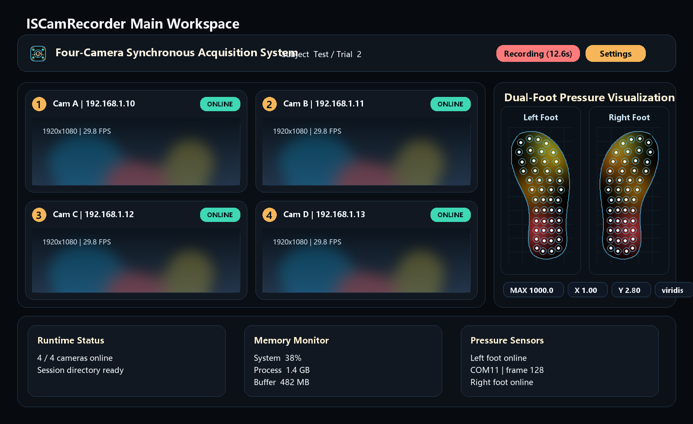
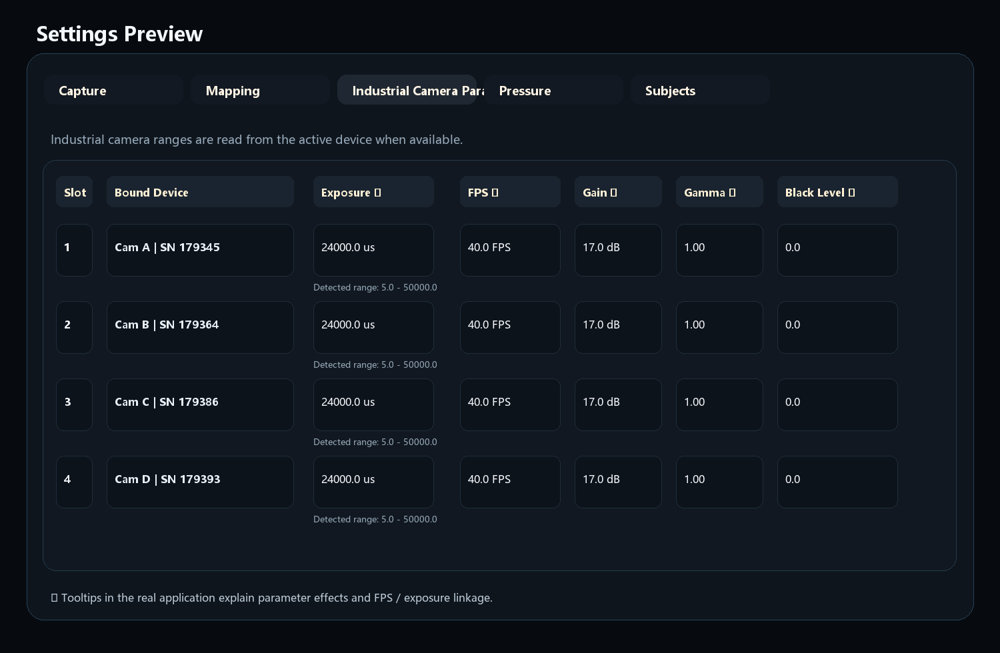

# ISCamRecorder Python Edition

<p align="right">
  <strong>English</strong> | <a href="./README.zh-CN.md">简体中文</a>
</p>

<p align="center">
  
</p>

<p align="center">
  A desktop acquisition console for synchronized four-camera recording and dual-foot pressure sensor visualization.
</p>

---

## Overview

This project is a **Python + PyQt5** desktop application that combines:

- four-channel Hikrobot MVS GigE industrial camera preview
- synchronized recording and snapshot capture
- dual-foot pressure sensor acquisition over USB serial
- real-time heatmap visualization
- session-based file output
- runtime memory monitoring for large buffered recordings

This GitHub repository contains the complete Python application, runtime assets, and deployment scripts needed for acquisition and packaging.

## Current UI Layout

The current main window is organized into three layers:

1. A compact top toolbar for subject name, trial index, recording control, snapshot, settings, and current status.
2. A central work area with resizable four-camera views on the left and dual-foot pressure heatmaps on the right.
3. A bottom information zone for runtime status, memory monitoring, and pressure sensor state/log feedback.

This layout is optimized for live acquisition workflows where operators need to watch video, sensor response, and system health at the same time.

## UI Preview

The images below are illustrative previews generated from the current UI layout, including the updated shoe-sole pressure contour visualization.

<p align="center">
  
</p>

<p align="center">
  
</p>

## Feature Summary

| Module | Description |
| --- | --- |
| Four-camera preview | Live previews for channels `1 / 2 / 3 / 4`, with resizable panes |
| Recording and snapshots | Recording exports `mp4 + per-frame images`; snapshots are stored in the `image/` directory |
| Dual-foot pressure capture | Independent left/right serial sensors with fixed-size binary frame parsing |
| Real-time heatmaps | Pressure heatmaps are rendered live in the main window |
| Session-based storage | Each recording creates its own subject/trial directory |
| Memory monitoring | Tracks system memory, process memory, and recording buffer estimates |

## Repository Structure

| Path | Purpose |
| --- | --- |
| `python_app/` | Main application package |
| `python_app/ui/` | Main window, settings dialog, styles, and visualization widgets |
| `python_app/mvs.py` | Hikrobot MVS GigE SDK adapter and pixel conversion layer |
| `python_app/mvs_vendor/` | Bundled MVS Python ctypes wrapper files |
| `foot_sensor_layout/` | Shoe-sole contour and sensor-point CSV assets used by the pressure visualization |
| `python_app/assets/branding/` | Logo, wordmark, and application icon assets |
| `docs/screenshots/` | README interface preview images |
| `python_app/tests/` | Basic configuration tests |
| `scripts/` | Helper scripts for branding assets, README previews, portable runtime staging, driver install, and release packaging |
| `run_python_app.py` | Application entry point |
| `settings.example.json` | Example runtime configuration template |
| `SubjectList.example.txt` | Example subject list template |

## Requirements

- Windows 10/11 64-bit
- Python 3.13+ (64-bit)
- Hikrobot MVS Runtime files
- PyQt5
- opencv-python
- pyserial
- numpy
- av
- psutil

Install dependencies:

```powershell
python -m pip install -r requirements.txt
```

Create local runtime configuration files:

```powershell
Copy-Item settings.example.json settings.json
Copy-Item SubjectList.example.txt SubjectList.txt
```

If you launch the app with the project-local `.conda` interpreter, install the dependencies into that interpreter too:

```powershell
& .\.conda\python.exe -m pip install -r requirements.txt
& .\.conda\python.exe .\run_python_app.py
```

This application now supports an **app-local MVS runtime**. It searches in this order:

1. `runtime/mvs/Win64_x64/` next to `run_python_app.py` or the packaged `.exe`
2. `C:\Program Files (x86)\Common Files\MVS\Runtime\Win64_x64`

That means you can either:

- install Hikrobot MVS on the machine, or
- copy the runtime DLL folder into `runtime/mvs/Win64_x64/` inside this project or packaged release

Start the application:

```powershell
python run_python_app.py
```

Regenerate branding assets only:

```powershell
python scripts/generate_branding_assets.py
```

Regenerate README preview images:

```powershell
python scripts/generate_readme_screenshots.py
```

Stage MVS runtime files into the current `Software/` folder for portable copy:

```powershell
powershell -ExecutionPolicy Bypass -File scripts/stage_mvs_runtime.ps1
```

## Release and Deployment

### Option 1. Deploy from source on another PC

1. Install 64-bit Python on the target machine.
2. Copy the repository folder to the target machine.
3. Install dependencies:

```powershell
python -m pip install -r requirements.txt
```

4. Prepare the MVS runtime in one of these two ways:
   - install Hikrobot MVS Runtime / Client on the target machine, or
   - run `scripts/stage_mvs_runtime.ps1` on the build machine first so the folder already contains `runtime/mvs/Win64_x64/`
5. Copy `settings.example.json` to `settings.json` and `SubjectList.example.txt` to `SubjectList.txt`.
6. Review `settings.json` and bind cameras by serial number if needed.
7. Launch:

```powershell
python run_python_app.py
```

### Option 2. Build a packaged release

A Windows packaging helper is included:

```powershell
powershell -ExecutionPolicy Bypass -File scripts/build_release.ps1
```

This produces:

- `dist/ISCamRecorder-Python/` — packaged application folder
- `dist/ISCamRecorder-Python-YYYYMMDD-HHMMSS.zip` — portable zip for delivery

The packaged output includes:

- the Python application
- UI assets and shoe-sole pressure contour resources
- pressure layout JSON files
- shoe-sole contour CSV files
- bundled MVS runtime DLLs under `runtime/mvs/Win64_x64/`
- optional GigE driver installer files under `drivers/mvs_gige/`
- local `settings.json` and `SubjectList.txt` if present, otherwise the example templates
- English and Chinese README files

The target machine does **not** need the full Hikrobot MVS Client when you use this packaged release, because the build script bundles the required MVS runtime DLLs. If GigE discovery or performance still needs the vendor network driver, run `install_mvs_gige_driver.ps1` as administrator on the target machine.

## MVS Camera Configuration

The current camera backend is **Hikrobot MVS GigE only**. OpenCV index probing is no longer used for the four recording channels.

The recommended workflow is:

1. Bind physical cameras from **Settings -> Camera Mapping**.
2. Tune exposure, frame rate, gain, gamma, and black level from **Settings -> Industrial Camera Parameters**.

The matching configuration section in `settings.json` is `camera_bindings[]`. Each camera entry contains:

- `slot`: internal slot identifier
- `device_serial`: stable camera serial number used for binding
- `output_id`: saved channel label, currently `1 / 2 / 3 / 4`
- `record_enabled`: whether the camera participates in recording
- `snapshot_enabled`: whether the camera participates in snapshots
- `exposure_time_us`: exposure time in microseconds
- `acquisition_frame_rate_fps`: requested acquisition frame rate
- `gain_db`: analog gain
- `gamma_value`: gamma correction value
- `black_level`: black level offset

Example:

```json
{
  "camera_bindings": [
    {
      "slot": "top",
      "device_serial": "00C86123456",
      "output_id": "1",
      "record_enabled": true,
      "snapshot_enabled": true,
      "exposure_time_us": 20000.0,
      "acquisition_frame_rate_fps": 30.0,
      "gain_db": 0.0,
      "gamma_value": 1.0,
      "black_level": 0.0
    },
    {
      "slot": "left",
      "device_serial": "00C86123457",
      "output_id": "2",
      "record_enabled": true,
      "snapshot_enabled": true,
      "exposure_time_us": 20000.0,
      "acquisition_frame_rate_fps": 30.0,
      "gain_db": 0.0,
      "gamma_value": 1.0,
      "black_level": 0.0
    }
  ]
}
```

At runtime the UI still shows **model name / user-defined name / serial / IP**, but only the serial is written back to configuration so that camera bindings survive IP or display-name changes.

The parameter page reads the active camera node ranges when possible and constrains the controls to the detected limits. Exposure time and acquisition frame rate are also linked together: a longer exposure lowers the maximum achievable FPS, and a higher FPS target lowers the allowed exposure ceiling.

If the application cannot load `MvCameraControl.dll`, the UI will show an explicit SDK warning instead of crashing.

## Pressure Sensor Configuration

Pressure sensors are configured separately for the left and right foot in **Settings -> Foot Pressure Sensors**.

The current implementation expects fixed 99-byte binary frames at 115200 baud. Each sensor entry supports:

| Field | Description |
| --- | --- |
| `sensor_id` | Fixed to `left_foot` or `right_foot` |
| `enabled` | Whether this sensor is enabled |
| `port` | Serial port, such as `COM3` |

Example:

```json
{
  "pressure_sensors": [
    {
      "sensor_id": "left_foot",
      "enabled": true,
      "port": "COM4"
    },
    {
      "sensor_id": "right_foot",
      "enabled": true,
      "port": "COM5"
    }
  ]
}
```

The heatmap visualization reads the sole outline and 48 sensor coordinates from `foot_sensor_layout/*_curve.csv` and `foot_sensor_layout/*_dots.csv`.

## Recording and Output

Each recording creates a dedicated session directory:

```text
recYYYYMMDD_HHMMSS_<subject>_<trial>
```

A typical output structure looks like this:

```text
rec20260325_213000_TestSubject_1/
├─ 1_20260325_213000.mp4
├─ 2_20260325_213000.mp4
├─ 3_20260325_213000.mp4
├─ 4_20260325_213000.mp4
├─ 1/
│  ├─ 1_213000.001.jpg
│  ├─ 1_213000.026.jpg
│  └─ ...
├─ 2/
├─ 3/
├─ 4/
└─ Pressure_20260325_213000.csv
```

Where:

- `1 / 2 / 3 / 4 .mp4` are the recorded camera videos
- `1 / 2 / 3 / 4 /` contain exported frame images
- `Pressure_*.csv` stores the pressure matrix data for both feet

## Pressure CSV Format

Pressure data is stored as one row per sensor frame.

| Column | Meaning |
| --- | --- |
| `frame_index` | Zero-based frame index within the saved CSV |
| `heartbeat_id` | Camera heartbeat bucket aligned to output camera `1` |
| `1` - `48` | Raw 16-bit values for the 48 pressure points |

## Recommended Workflow

### 1. Initial Setup

1. Install dependencies.
2. Launch the application.
3. Bind the four cameras in Settings.
4. Configure left and right foot serial ports.
5. Return to the main window and verify that camera previews and pressure heatmaps are updating correctly.

### 2. Data Acquisition

1. Enter the subject name and confirm the trial index.
2. Check runtime status, memory usage, and pressure sensor connectivity.
3. Click `Start Recording`.
4. Observe the four camera views and both foot heatmaps during acquisition.
5. Click `Stop Recording` and wait for the save stage to finish.

### 3. Data Validation

- Verify that the session directory was created.
- Verify that all four `mp4` files exist and are complete.
- Verify that per-frame image directories were generated.
- Verify that `Pressure_*.csv` contains continuous records.

## Troubleshooting

### The app says PyQt5 is missing

Run:

```powershell
python -m pip install -r requirements.txt
```

### Camera previews do not appear

Check the following first:

- the correct `device_name` is bound in Settings
- the camera is not already occupied by another application
- Windows camera access is enabled for desktop applications

### Pressure heatmaps do not update

Check the following first:

- the sensor is enabled
- the serial port is correct
- the device is sending the fixed 99-byte frame format with header `0x40`, foot id `0x31`/`0x32`, 48 big-endian 16-bit values, and checksum

### Memory usage remains high after recording

The current design uses a **buffer first, save later** model. Long recordings and high-resolution streams can consume significant RAM.

Recommended mitigations:

- shorten a single recording session
- reduce camera resolution or frame rate
- watch the memory monitor before starting a very long acquisition

## Notes

This repository is intended to be the maintained codebase for the **Python desktop acquisition system**.

If you plan to extend the project, the current repository is the recommended base for future work, for example:

- persisting splitter layouts
- adding more pressure sensor protocol adapters
- building data playback or export tools
- writing full hardware integration guides

