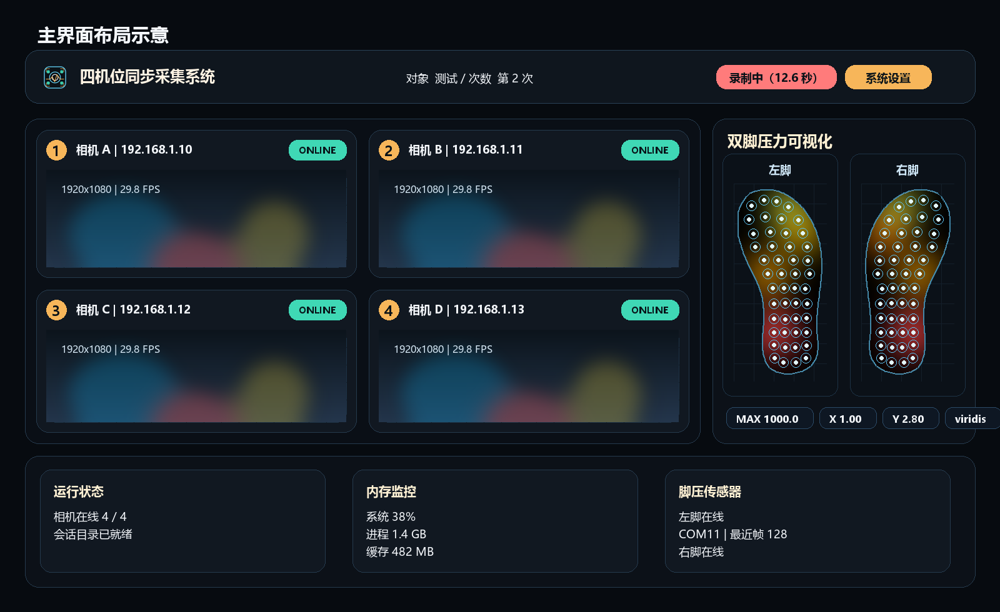
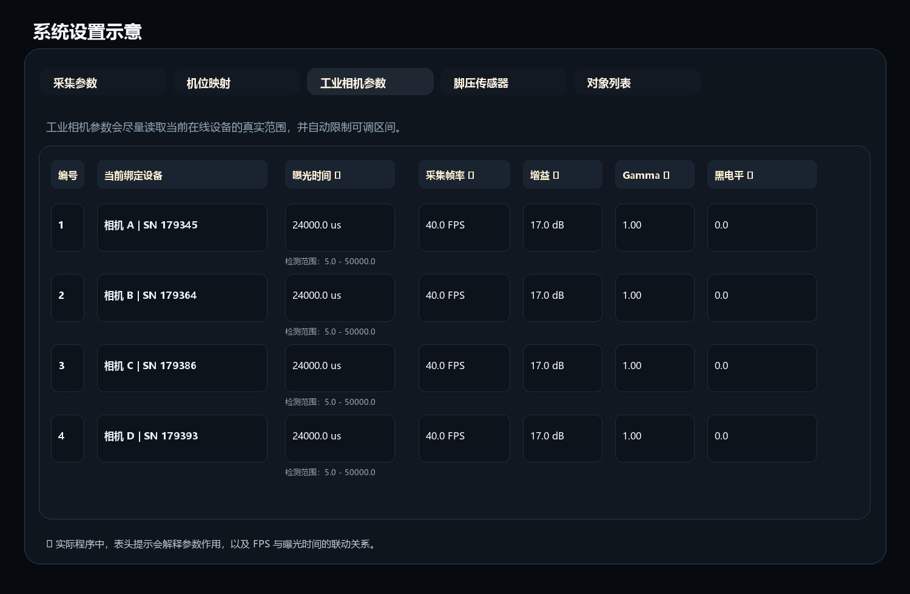

# ISCamRecorder Python 版

<p align="right">
  <a href="./README.md">English</a> | <strong>简体中文</strong>
</p>

<p align="center">
  
</p>

<p align="center">
  面向四路相机同步采集与双脚压力传感器可视化的桌面采集系统
</p>

---

## 项目简介

这是一个基于 **Python + PyQt5** 的桌面采集系统，用于将四路海康 MVS GigE 工业相机采集、双脚压力传感器采集、实时可视化和会话化保存整合到一个操作台中。

当前 GitHub 仓库包含完整的 Python 应用、运行资源和发布打包脚本，可直接用于部署和持续迭代。

它解决的核心问题是：

- 同时管理 4 路相机预览、录像和拍照
- 同时接入左右脚两路压力传感器
- 在一个界面里完成实时观察、录制控制与结果保存
- 录制结束后自动输出视频、逐帧图像和脚压 CSV
- 在长时间录制时持续监控内存占用，降低缓存爆内存的风险

## 当前界面布局

当前主界面采用三层结构：

1. 顶部为紧凑控制栏：对象、次数、开始录制、拍照、系统设置和运行状态。
2. 中间主工作区：左侧为四路相机自由缩放区域，右侧为上下排布的左右脚热力图。
3. 底部状态区：运行状态、内存监控、脚压传感器状态与日志。

这套布局适合边采集边观察，不需要频繁切换页面。

## 界面示意图

下面两张图是根据当前界面结构生成的 README 示意图，已经同步到当前版本的鞋底压力轮廓可视化样式。

<p align="center">
  
</p>

<p align="center">
  
</p>

## 功能概览

| 模块 | 说明 |
| --- | --- |
| 四路相机预览 | 1/2/3/4 四个机位同时预览，窗口支持拖拽分割条自由调整大小 |
| 录像与拍照 | 录像结束后输出 `mp4 + 逐帧图片`，拍照输出到 `image/` 目录 |
| 双脚压力采集 | 左脚与右脚各一路独立串口，支持固定长度二进制帧解析 |
| 实时热力图 | 在主界面右侧实时显示左右脚压力热力图 |
| 会话化保存 | 每次录制按对象名和次数创建独立目录 |
| 内存监控 | 实时显示系统内存、进程内存和录制缓存估算 |

## 仓库结构

| 路径 | 作用 |
| --- | --- |
| `python_app/` | 主应用代码 |
| `python_app/ui/` | 主窗口、设置页、样式和可视化控件 |
| `python_app/mvs.py` | 海康 MVS GigE SDK 适配与像素格式转换层 |
| `python_app/mvs_vendor/` | 内置的 MVS Python ctypes 封装文件 |
| `foot_sensor_layout/` | 鞋底轮廓与传感器点位 CSV 资源，供脚压可视化使用 |
| `python_app/assets/branding/` | Logo、字标和应用图标资源 |
| `docs/screenshots/` | README 界面示意图 |
| `python_app/tests/` | 当前保留的基础配置测试 |
| `scripts/` | 品牌资源、README 示意图、便携运行库准备、驱动安装和发布打包脚本 |
| `run_python_app.py` | 直接启动入口 |
| `settings.example.json` | 运行配置模板 |
| `SubjectList.example.txt` | 对象列表模板 |

## 运行环境

- Windows 10/11 64 位
- Python 3.13+（64 位）
- 海康 MVS Runtime 文件
- PyQt5
- opencv-python
- pyserial
- numpy
- av
- psutil

安装依赖：

```powershell
python -m pip install -r requirements.txt
```

创建本机运行配置：

```powershell
Copy-Item settings.example.json settings.json
Copy-Item SubjectList.example.txt SubjectList.txt
```

如果使用项目目录里的 `.conda` 解释器启动程序，依赖也要装进同一个解释器：

```powershell
& .\.conda\python.exe -m pip install -r requirements.txt
& .\.conda\python.exe .\run_python_app.py
```

当前程序已经支持 **应用目录本地 MVS Runtime**，会按下面的顺序查找：

1. `run_python_app.py` 或打包后的 `.exe` 同级目录下的 `runtime/mvs/Win64_x64/`
2. `C:\Program Files (x86)\Common Files\MVS\Runtime\Win64_x64`

也就是说，你可以选择：

- 在目标电脑安装海康 MVS Runtime / Client
- 或者把 Runtime DLL 复制到当前项目或打包目录的 `runtime/mvs/Win64_x64/`

启动应用：

```powershell
python run_python_app.py
```

如果你只想重新生成品牌资源：

```powershell
python scripts/generate_branding_assets.py
```

如果你只想重新生成 README 界面示意图：

```powershell
python scripts/generate_readme_screenshots.py
```

如果你想把 MVS Runtime 预先拷进当前 `Software/` 目录，方便整包拷到别的电脑：

```powershell
powershell -ExecutionPolicy Bypass -File scripts/stage_mvs_runtime.ps1
```

## 发布与换机部署

### 方案 1：直接复制源码部署

1. 在目标电脑安装 64 位 Python。
2. 把整个仓库目录复制到目标电脑。
3. 安装依赖：

```powershell
python -m pip install -r requirements.txt
```

4. 用下面两种方式之一准备 MVS Runtime：
   - 在目标电脑安装海康 MVS Runtime / Client
   - 或者先在打包机上运行 `scripts/stage_mvs_runtime.ps1`，让项目目录里已经带上 `runtime/mvs/Win64_x64/`
5. 把 `settings.example.json` 复制为 `settings.json`，把 `SubjectList.example.txt` 复制为 `SubjectList.txt`。
6. 根据实际设备检查 `settings.json`，按序列号重新绑定相机。
7. 启动程序：

```powershell
python run_python_app.py
```

### 方案 2：构建可分发 release 包

仓库里已经提供了 Windows 打包脚本：

```powershell
powershell -ExecutionPolicy Bypass -File scripts/build_release.ps1
```

执行后会生成：

- `dist/ISCamRecorder-Python/`：打包后的应用目录
- `dist/ISCamRecorder-Python-YYYYMMDD-HHMMSS.zip`：方便拷贝和分发的压缩包

打包结果会包含：

- Python 主程序
- UI 资源和鞋底压力轮廓资源
- 脚压布局 JSON 文件
- 鞋底轮廓 CSV 文件
- `runtime/mvs/Win64_x64/` 下的 MVS Runtime DLL
- `drivers/mvs_gige/` 下的可选 GigE 驱动安装文件
- 如果存在则包含本机 `settings.json` 和 `SubjectList.txt`，否则使用 example 模板
- 中英文 README

使用这个打包结果时，目标电脑**不再必须安装完整的海康 MVS Client**，因为打包脚本会把所需的 MVS Runtime DLL 一起带上。如果目标电脑的 GigE 发现或吞吐仍然依赖厂商网卡驱动，再以管理员身份运行 `install_mvs_gige_driver.ps1` 即可。

## MVS 工业相机配置

当前四路相机后端固定为 **海康 MVS GigE 工业相机**，不再使用 OpenCV 索引扫描作为主采集方式。

推荐流程是：

1. 在 **系统设置 -> 机位映射** 中绑定物理相机。
2. 在 **系统设置 -> 工业相机参数** 中调整曝光时间、采集帧率、增益、Gamma 和黑电平。

配置文件中对应字段是 `camera_bindings[]`，每个机位包含：

- `slot`：内部机位标识
- `device_serial`：用于长期绑定的工业相机序列号
- `output_id`：保存编号，默认是 `1/2/3/4`
- `record_enabled`：是否参与录像
- `snapshot_enabled`：是否参与拍照
- `exposure_time_us`：曝光时间，单位微秒
- `acquisition_frame_rate_fps`：目标采集帧率
- `gain_db`：模拟增益
- `gamma_value`：Gamma 校正值
- `black_level`：黑电平偏移

示例：

```json
{
  "camera_bindings": [
    {
      "slot": "top",
      "device_serial": "00C86123456",
      "output_id": "1",
      "record_enabled": true,
      "snapshot_enabled": true,
      "exposure_time_us": 20000.0,
      "acquisition_frame_rate_fps": 30.0,
      "gain_db": 0.0,
      "gamma_value": 1.0,
      "black_level": 0.0
    },
    {
      "slot": "left",
      "device_serial": "00C86123457",
      "output_id": "2",
      "record_enabled": true,
      "snapshot_enabled": true,
      "exposure_time_us": 20000.0,
      "acquisition_frame_rate_fps": 30.0,
      "gain_db": 0.0,
      "gamma_value": 1.0,
      "black_level": 0.0
    }
  ]
}
```

界面运行时仍会显示 **型号 / 自定义名 / 序列号 / IP**，但真正写回配置文件的只有序列号，这样即使换网段或改设备名，机位绑定也不会失效。

工业相机参数页会尽量读取当前在线相机的节点范围，并据此约束输入控件。曝光时间和采集帧率之间也会自动联动：曝光越长，可达到的最高帧率越低；目标帧率越高，可允许的曝光上限越低。

如果程序无法加载 `MvCameraControl.dll`，界面会给出明确的 SDK 提示，而不是直接崩溃。

## 脚压传感器配置

脚压传感器通过 **系统设置 -> 脚压传感器** 页面分别配置左脚和右脚。

系统当前采用 115200 波特率、99 字节固定二进制帧模式，每路配置项目前为：

| 字段 | 说明 |
| --- | --- |
| `sensor_id` | 固定为 `left_foot` 或 `right_foot` |
| `enabled` | 是否启用该路传感器 |
| `port` | 串口号，例如 `COM3` |

示例：

```json
{
  "pressure_sensors": [
    {
      "sensor_id": "left_foot",
      "enabled": true,
      "port": "COM4"
    },
    {
      "sensor_id": "right_foot",
      "enabled": true,
      "port": "COM5"
    }
  ]
}
```

脚底热力图直接读取 `foot_sensor_layout/*_curve.csv` 和 `foot_sensor_layout/*_dots.csv` 中的鞋底轮廓与 48 个传感器点位。

## 录制与输出

每次录像都会创建一个独立目录：

```text
recYYYYMMDD_HHMMSS_对象名_次数
```

典型输出结构如下：

```text
rec20260325_213000_测试对象_1/
├─ 1_20260325_213000.mp4
├─ 2_20260325_213000.mp4
├─ 3_20260325_213000.mp4
├─ 4_20260325_213000.mp4
├─ 1/
│  ├─ 1_213000.001.jpg
│  ├─ 1_213000.026.jpg
│  └─ ...
├─ 2/
├─ 3/
├─ 4/
└─ Pressure_20260325_213000.csv
```

其中：

- `1/2/3/4.mp4` 是四路机位录像文件。
- `1/2/3/4/` 目录下是逐帧导出的静态图。
- `Pressure_*.csv` 是双脚压力数据表。

## Pressure CSV 结构

脚压数据按传感器帧逐行保存。

| 列名 | 含义 |
| --- | --- |
| `frame_index` | 当前 CSV 内从 0 开始的帧编号 |
| `heartbeat_id` | 按 1 号输出相机对齐得到的心跳段编号 |
| `1` - `48` | 48 个压力点的原始 16-bit 值 |

## 使用流程建议

### 1. 首次使用

1. 安装依赖。
2. 启动程序。
3. 在系统设置里绑定四路相机。
4. 在脚压传感器页配置左右脚串口。
5. 返回主界面，确认相机画面和脚压热力图都正常刷新。

### 2. 正式采集

1. 在顶部输入对象名称并确认次数。
2. 检查底部运行状态、内存监控和脚压连接状态。
3. 点击“开始录制”。
4. 录制期间实时观察四机位与双脚压力。
5. 点击“停止录制”，等待自动保存完成。

### 3. 数据核查

- 检查会话目录是否生成。
- 检查 4 个 `mp4` 文件是否完整。
- 检查逐帧图片目录是否存在。
- 检查 `Pressure_*.csv` 是否有连续数据。

## 排障建议

### 程序启动提示缺少 PyQt5

执行：

```powershell
python -m pip install -r requirements.txt
```

### 看不到相机画面

优先检查：

- 是否已在系统设置里绑定正确的 `device_name`
- 相机是否被其他软件占用
- Windows 是否允许应用访问摄像头

### 脚压热力图不刷新

优先检查：

- 对应传感器是否启用
- 串口号是否正确
- 设备是否输出固定 99 字节帧：帧头 `0x40`、脚编号 `0x31`/`0x32`、48 个大端 16-bit 值和校验位

### 录制后内存过高

当前版本采用“先缓存、后统一保存”的策略。长时间录制或高分辨率采集会显著占用内存，建议：

- 缩短单次录制时长
- 降低相机分辨率或帧率
- 先观察底部内存监控是否持续上升

## 说明

这个仓库用于维护 **Python 版本** 的桌面采集系统代码。

若后续需要继续扩展，比如：

- 保存分割条布局
- 增加脚压协议适配器
- 增加数据回放或导出工具
- 增加真正的设备联调说明

建议后续直接在当前仓库基础上继续迭代。

